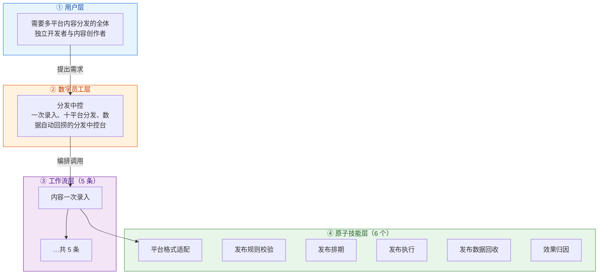
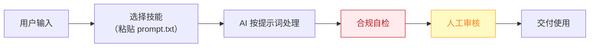

# 分发中控 — 业务架构

## 四层视图

## 资产形态说明

本资产包为**纯提示词客户端资产**：

| 特性 | 说明 |
|------|------|
| 无运行时依赖 | 不调用任何模型 API，不需要 API Key |
| 平台无关 | 提示词为纯文本，可导入任意主流 AI 平台 |
| 用户自备算力 | 模型由用户自己的订阅提供 |
| 零服务端成本 | 资产方不产生任何调用费用 |

## 数据流

> **关键设计**：所有对外输出必须经过「合规自检 → 人工审核」双闸门。

## 能力边界

| 维度 | 内容 |
|------|------|
| **目标用户** | 需要多平台内容分发的全体独立开发者与内容创作者 |
| **做** | 格式适配、定时发布编排、数据回捞与归因报表 |
| **不做** | 不做：绕过平台风控的自动登录发帖（发布执行依托 MultiPost 类工具/官方 API）、刷量 |
| **KPI** | 单篇内容分发平台数 ≥8；分发耗时 ≤10 分钟/篇；数据回捞覆盖率 ≥90% |
| **定价** | ¥29-69/月——MultiPost 免费压死了"发出去"的定价空间，本员工卖的是"数据回收 + AI 改写"增值闭环；ROI 汇总：日更用户月省约 20h ≈ ¥1600 |

---

*本图由 build_p0_assets.py 自动生成*
