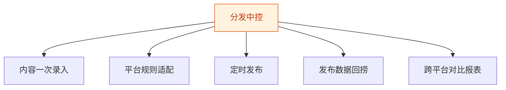

# 分发中控 — 工作流流程图

本员工共 **5 条工作流**，下辖 **6 个原子技能**。

## 总览

## 分条详情

### 内容一次录入

| 项目 | 内容 |
|------|------|
| 触发 | 人工 |
| 复杂度 | `S` |
| 阶段 | `P1` |
| ROI | — |

### 平台规则适配

| 项目 | 内容 |
|------|------|
| 触发 | 事件（录入后） |
| 复杂度 | `S` |
| 阶段 | `P1` |
| ROI | 省 0.5h/篇 |

### 定时发布

| 项目 | 内容 |
|------|------|
| 触发 | 定时 |
| 复杂度 | `M` |
| 阶段 | `P1` |
| ROI | 省 0.5h/篇，日更者月省 15h ≈ ¥1200 |

### 发布数据回捞

| 项目 | 内容 |
|------|------|
| 触发 | 定时（T+1/T+7） |
| 复杂度 | `M` |
| 阶段 | `P1` |
| ROI | 省 0.3h/日 ≈ ¥720/月 |

### 跨平台对比报表

| 项目 | 内容 |
|------|------|
| 触发 | 定时（每周） |
| 复杂度 | `S` |
| 阶段 | `P2` |
| ROI | 决策提质 |

## 汇总表

| # | 工作流 | 阶段 | 复杂度 | 触发 | 涉及技能数 |
|---|--------|------|--------|------|-----------|
| 1 | 内容一次录入 | `P1` | `S` | 人工 | 1 |
| 2 | 平台规则适配 | `P1` | `S` | 事件（录入后） | 2 |
| 3 | 定时发布 | `P1` | `M` | 定时 | 2 |
| 4 | 发布数据回捞 | `P1` | `M` | 定时（T+1/T+7） | 1 |
| 5 | 跨平台对比报表 | `P2` | `S` | 定时（每周） | 1 |

---

*本图由 build_p0_assets.py 自动生成*
