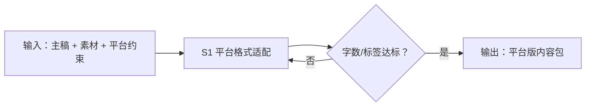

# 内容一次录入

把「主稿 + 素材录入」一次做对：主稿按目标平台格式约束完成改写与元信息补全，
交付可直接进入校验与排期的平台版内容包。

## 元信息

| 字段 | 值 |
|------|-----|
| ID | `de_dev_05_wf01` |
| 类型 | **`composite`（复合技能）** |
| 所属员工 | 分发中控 |
| 阶段 | `P1` |
| 复杂度 | `S` |
| 触发方式 | 人工 |
| ROI | — |
| 资产形态 | 提示词编排 + Python 确定性脚本（无外部 API 依赖） |

> 复合技能 = 工作流。它把多个**原子技能**按业务顺序编排在一起，完成一个完整场景。

## 能力描述

1. **S1 平台格式改写**：按平台硬约束（小红书正文 ≤ 1000 字、话题标签 3-5 个）
   改写主稿——长段拆为 ≤ 40 字编号短句，数字/价格/时间与原文逐项对照零改动
2. **元信息补全**：标题（≤ 20 字）、话题标签、配图清单、目标发布窗口
3. **约束核对**：字数、标签数、事实一致三项逐条出核对表，超限即返工
4. **确定性脚本**：`scripts/run_flow.py` 承担字数统计、句子编号重排、
   约束核对与产物落盘（`out/step1_adapt.json`、`out/录入包.csv`、`out/flow_result.json`）

## 编排的原子技能

| # | 原子技能 | 能力 |
|---|---------|------|
| 1 | [平台格式适配](../../skills/platform-format-adapt/) | 保留原意的平台格式改写（字数/标签硬约束） |

## 步骤链路（DAG）



## 步骤明细

| # | 步骤 | 技能资产 | 输入 | 输出 | 失败处理 |
|---|------|---------|------|------|---------|
| 1 | 平台格式适配 | [`../../skills/platform-format-adapt/`](../../skills/platform-format-adapt/) + 本流脚本 | 主稿 + 平台约束 | 改写稿 + 约束核对表 | 超限二次压缩；事实被改即整体退回 |

## 步骤说明

主稿 + 素材录入 → 元信息补全

## 输入规格

| 字段 | 类型 | 必填 | 说明 |
|------|------|------|------|
| `input` | string / object | ✅ | 主稿原文 + 目标平台 + 字数/标签要求 + 素材清单 |

## 输出规格

| 字段 | 类型 | 说明 |
|------|------|------|
| `summary` | string | 执行摘要（改写后字数与达标情况） |
| `steps` | string | 分步结果（含约束核对表） |
| `deliverable` | string | 平台版内容包：标题 + 正文 + 标签 + 配图清单 |
| 产物 | file | `out/step1_adapt.json`、`out/录入包.csv`、`out/flow_result.json` |

## 错误处理

| 情况 | 处理方式 |
|------|---------|
| 输入缺失 | 提示缺少的字段，终止流程 |
| 改写稿超字数上限 | 二次压缩（删冗余修饰 → 合并论据 → 压案例），禁删核心事实 |
| 事实被改动 | 整体退回重改，不交付 |
| 提示词被平台截断 | 拆分任务，分两次处理 |

## 验收标准

- [ ] 每一步的技能资产齐全（SKILL.md / prompt.txt / schema.json）
- [ ] 步骤间输入输出字段可衔接
- [ ] 约束核对表 3 项全部达标（字数 / 标签数 / 事实一致）
- [ ] 末步输出带 AI 生成标识
- [ ] 全流程有人工确认环节

## 使用步骤

### 方式一：纯提示词编排（跨平台）

1. 把 `prompt.txt` 全文粘贴为系统提示词
2. 提供主稿原文 + 目标平台 + 字数/标签要求 + 素材清单
3. 按步骤 1 完成改写与元信息补全，核对约束核对表
4. 数值用下方脚本实测，不靠模型口算

### 方式二：带脚本（端到端产物）

```bash
python <WF_DIR>/scripts/run_flow.py --input examples/input.json --outdir out
python <WF_DIR>/scripts/run_flow.py --demo      # 无输入也能看端到端效果
```

| 平台 | 编排方式 |
|------|---------|
| **Coze / 扣子** | 工作流节点填 S1 技能 prompt.txt，代码节点跑核对脚本 |
| **Dify** | Workflow → LLM 节点链 + 代码节点 |
| **WorkBuddy** | 新建 Skill 按 prompt.txt 步骤串联 |

## 边界（不做的事）

- ❌ 不做合规终审——交付后必须过 publish-rules-validate
- ❌ 不定排期、不执行发布（交给 publish-schedule / publish-execute）
- ❌ 不改原文事实：数字、价格、时间改动即为不合格
- ❌ 不猜缺失字段——列缺失清单让用户补
- ❌ 不用模型口算字数——以脚本计数为准

## 调用示例

**输入**（`examples/input.json`）：《小户型收纳的 5 个实用技巧》主稿，
目标小红书笔记 ≤ 300 字、3-5 个话题标签，封面 + 内容图 5 张。

**输出**（脚本实跑）：改写稿约 280 字 ≤ 300 字达标，5 个技巧编号重排、
800 元 / 40% / 29 元等数字零改动；约束核对 3 项出表，
内容包台账与端到端结果落 `out/`。

## 所属工作流

本资产为复合技能（工作流），是「一次录入、多端分发」链路的入口；
下游接 `publish-rules-adapt-flow`（规则适配与校验）、
`scheduled-publish-flow`（定时发布）。

## 合规声明

- 输出标注「AI 生成内容」；发布前过 publish-rules-validate 并人工复核
- 改写仅限用户自有内容，不搬运、不洗稿第三方版权内容
- 对外发布动作保留人工确认环节
