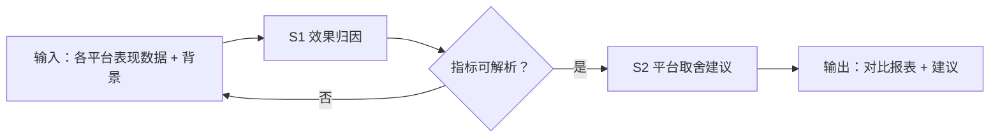

# 跨平台对比报表

把同一篇内容在各平台的表现数据收拢成一张同口径对比报表：先归因，再给平台取舍建议。

## 元信息

| 字段 | 值 |
|------|-----|
| ID | `de_dev_05_wf05` |
| 类型 | **`composite`（复合技能）** |
| 所属员工 | 分发中控 |
| 阶段 | `P2` |
| 复杂度 | `S` |
| 触发方式 | 定时（每周） |
| ROI | 决策提质 |
| 资产形态 | 提示词编排 + Python 确定性脚本（无外部 API 依赖） |

> 复合技能 = 工作流。它把多个**原子技能**按业务顺序编排在一起，完成一个完整场景。

## 能力描述

1. **S1 效果归因**：派生指标同口径化（互动率 =（点赞+收藏+评论）÷ 阅读 × 100%）、
   差异分解（活动加成阈值 ≥ 30%、选题适配阈值 ≥ 20%）、置信度标注
   （平台 < 3 个只报相关不定因果）
2. **S2 平台取舍建议**：每平台 1 条加大投入 / 维持现状 / 收缩，附量化理由，
   建议总数 2-4 条
3. **确定性脚本**：`scripts/run_flow.py` 承担派生指标计算、阈值判定与产物落盘
   （`out/step1_attribution.json`、`out/跨平台对比表.csv`、`out/flow_result.json`）

## 编排的原子技能

| # | 原子技能 | 能力 |
|---|---------|------|
| 1 | [效果归因](../../skills/effect-attribution/) | 跨平台效果对比与归因分析（A1-A4 量化规则） |

## 步骤链路（DAG）



## 步骤明细

| # | 步骤 | 技能资产 | 输入 | 输出 | 失败处理 |
|---|------|---------|------|------|---------|
| 1 | 效果归因 | [`../../skills/effect-attribution/`](../../skills/effect-attribution/) + 本流脚本 | 各平台指标 + 背景 | 派生指标 + 驱动因素 | 指标解析失败即中止并列缺失清单 |
| 2 | 平台取舍建议 | 本流（读步骤 1 产物） | step1_attribution.json | 2-4 条建议 | 无驱动因素时给「维持观察」基线建议 |

## 步骤说明

平台间效果归因 → 平台取舍建议

## 输入规格

| 字段 | 类型 | 必填 | 说明 |
|------|------|------|------|
| `input` | string / object | ✅ | 各平台表现数据（平台 + 曝光/阅读 + 点赞 + 收藏 + 评论）+ 背景信息 + 分析目的 |

## 输出规格

| 字段 | 类型 | 说明 |
|------|------|------|
| `summary` | string | 执行摘要（平台数 / 互动率均值 / 驱动因素数 / 置信度） |
| `steps` | string | 分步结果（归因明细 + 建议） |
| `deliverable` | string | 跨平台对比报表 + 归因结论 + 取舍建议 |
| 产物 | file | `out/step1_attribution.json`、`out/跨平台对比表.csv`、`out/flow_result.json` |

## 错误处理

| 情况 | 处理方式 |
|------|---------|
| 输入缺失 | 提示缺少的字段，终止流程 |
| 指标解析失败 | 列出缺失清单请用户补，不补零、不猜数 |
| 平台数 < 3 | 只报相关不定因果，建议降级表述 |
| 提示词被平台截断 | 拆分任务，分两次处理 |

## 验收标准

- [ ] 每一步的技能资产齐全（SKILL.md / prompt.txt / schema.json）
- [ ] 步骤间输入输出字段可衔接（S2 读取 S1 的 step1_attribution.json）
- [ ] 每个平台一行派生指标，口径统一
- [ ] 建议条数在 2-4 条区间且每条带数字依据
- [ ] 末步输出带 AI 生成标识

## 使用步骤

### 方式一：纯提示词编排（跨平台）

1. 把 `prompt.txt` 全文粘贴为系统提示词
2. 提供各平台表现数据与背景信息
3. 按步骤 1 → 步骤 2 得到对比报表与建议
4. 数值用下方脚本实测，不靠模型口算

### 方式二：带脚本（端到端产物）

```bash
python <WF_DIR>/scripts/run_flow.py --input examples/input.json --outdir out
python <WF_DIR>/scripts/run_flow.py --demo      # 无输入也能看端到端效果
```

| 平台 | 编排方式 |
|------|---------|
| **Coze / 扣子** | 工作流节点填 S1 技能 prompt.txt，代码节点跑归因脚本 |
| **Dify** | Workflow → LLM 节点链 + 代码节点 |
| **WorkBuddy** | 新建 Skill 按 prompt.txt 步骤串联 |

## 边界（不做的事）

- ❌ 不采集数据——数据回收交给 publish-data-collect
- ❌ 不跨口径比较（拿曝光比互动、拿收藏比评论）
- ❌ 不把相关当因果——平台 < 3 个或无背景信息时降级表述
- ❌ 不改稿、不定排期、不执行发布
- ❌ 不编造缺失指标——列清单让用户补

## 调用示例

**输入**（`examples/input.json`）：《家庭收纳工具实测》9 月三平台数据
（小红书 / 知乎 / B站）+ 背景（小红书带「秋季焕新家」活动标签）。

**输出**（脚本实跑）：互动率小红书最高且高于其余平台均值 ≥ 30% →
「活动加成」驱动因素命中；建议 3 条（小红书加大投入 / 知乎维持 / B站观察），
对比表与归因结果落 `out/`。

## 所属工作流

本资产为复合技能（工作流），上游接 `publish-data-retrieval-flow`（数据回捞），
结论供周报与 `scheduled-publish-flow` 的时段权重调整使用。

## 合规声明

- 输出标注「AI 生成内容」；报表与建议须人工复核后使用
- 平台后台数据含账号商业信息，不对外披露明细、不外传原始数据文件
- 涉及竞品对比只使用公开可见数据
