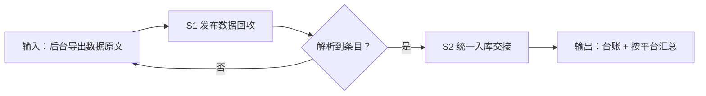

# 发布数据回捞

把用户粘贴的平台后台导出数据按 T+1 / T+7 节奏回收成统一台账：逐条登记、
按平台汇总、质量显式标注，交付可直接入库的明细与汇总。

## 元信息

| 字段 | 值 |
|------|-----|
| ID | `de_dev_05_wf04` |
| 类型 | **`composite`（复合技能）** |
| 所属员工 | 分发中控 |
| 阶段 | `P1` |
| 复杂度 | `M` |
| 触发方式 | 定时（T+1/T+7） |
| ROI | 省 0.3h/日 ≈ ¥720/月 |
| 资产形态 | 提示词编排 + Python 确定性脚本（无外部 API 依赖） |

> 复合技能 = 工作流。它把多个**原子技能**按业务顺序编排在一起，完成一个完整场景。

## 能力描述

1. **S1 数据回收**：从导出文本逐条提取「标题 / 平台 / 时间 / 阅读 / 点赞 /
   收藏 / 评论 / 涨粉」，按「平台+标题+时间」去重，单来源 50 条上限，
   完整字段占比 < 80% 标「部分缺失」，解析不到的字段显式标注不补零
2. **S2 统一入库**：台账 CSV 字段与顺序固定（10 列），按回捞批次区分
   T+1 / T+7，不覆盖历史行
3. **确定性脚本**：`scripts/run_flow.py` 承担解析、去重、质量标注、汇总与
   产物落盘（`out/step1_collect.json`、`out/数据回收台账.csv`、`out/flow_result.json`）

## 编排的原子技能

| # | 原子技能 | 能力 |
|---|---------|------|
| 1 | [发布数据回收](../../skills/publish-data-collect/) | 各平台公开表现数据采集与统一台账整理 |

## 步骤链路（DAG）



## 步骤明细

| # | 步骤 | 技能资产 | 输入 | 输出 | 失败处理 |
|---|------|---------|------|------|---------|
| 1 | 发布数据回收 | [`../../skills/publish-data-collect/`](../../skills/publish-data-collect/) + 本流脚本 | 导出数据原文 | 台账明细 + 汇总 + 质量报告 | 解析 0 条即中止并列期望格式 |
| 2 | 统一入库交接 | 本流（读步骤 1 产物） | step1_collect.json | 入库台账 CSV + 批次说明 | 字段缺失显式标注，不补零 |

## 步骤说明

各平台阅读/互动发布数据回收 → 统一入库

## 输入规格

| 字段 | 类型 | 必填 | 说明 |
|------|------|------|------|
| `input` | string / object | ✅ | 平台后台导出数据原文（含《标题》+ 发布时间 + 各项数字） |

## 输出规格

| 字段 | 类型 | 说明 |
|------|------|------|
| `summary` | string | 执行摘要（条数 / 覆盖平台 / 质量） |
| `steps` | string | 分步结果（采集结果 + 汇总 + 入库交接） |
| `deliverable` | string | 统一台账 + 按平台汇总 |
| 产物 | file | `out/step1_collect.json`、`out/数据回收台账.csv`、`out/flow_result.json` |

## 错误处理

| 情况 | 处理方式 |
|------|---------|
| 输入缺失 | 提示缺少的字段，终止流程 |
| 解析 0 条 | 中止并列出期望格式请用户补，不虚构条目 |
| 来源平台需要登录且无导出数据 | 该来源记 0 条并注明「需用户提供后台导出」 |
| 条目重复 | 按「平台 + 标题 + 时间」去重，保留字段最全的一行 |

## 验收标准

- [ ] 每一步的技能资产齐全（SKILL.md / prompt.txt / schema.json）
- [ ] 步骤间输入输出字段可衔接（S2 读取 S1 的 step1_collect.json）
- [ ] 每行 6 个字段齐备，缺失显式标注
- [ ] 台账 CSV 字段名与顺序固定，UTF-8 BOM 可直接入库
- [ ] 末步输出带 AI 生成标识

## 使用步骤

### 方式一：纯提示词编排（跨平台）

1. 把 `prompt.txt` 全文粘贴为系统提示词
2. 粘贴平台后台导出数据原文
3. 按步骤 1 → 步骤 2 得到台账与入库交接说明
4. 数值用下方脚本实测，不靠模型口算

### 方式二：带脚本（端到端产物）

```bash
python <WF_DIR>/scripts/run_flow.py --input examples/input.json --outdir out
python <WF_DIR>/scripts/run_flow.py --demo      # 无输入也能看端到端效果
```

| 平台 | 编排方式 |
|------|---------|
| **Coze / 扣子** | 工作流节点填 S1 技能 prompt.txt，代码节点跑解析脚本 |
| **Dify** | Workflow → LLM 节点链 + 代码节点 |
| **WorkBuddy** | 新建 Skill 按 prompt.txt 步骤串联 |

## 边界（不做的事）

- ❌ 不抓取需登录的私域数据、不绕过平台风控
- ❌ 不做归因分析（交给 cross-platform-report-flow）
- ❌ 不编造条目或数字：解析不到就列清单请用户补
- ❌ 不覆盖历史回捞批次
- ❌ 不定排期、不执行发布

## 调用示例

**输入**（`examples/input.json`）：小红书创作服务平台 + 知乎创作者中心
2026-10-05 导出数据（3 条内容，含浏览/点赞/收藏/评论数字）。

**输出**（脚本实跑）：回收 3 条、覆盖 2 个平台、全部字段完整；
按平台汇总出表（小红书 93,500 浏览 / 知乎 11,200 阅读），
台账 CSV 与批次说明落 `out/`。

## 所属工作流

本资产为复合技能（工作流），上游接 `scheduled-publish-flow` 的发布结果回填，
下游接 `cross-platform-report-flow`（对比报表）与周报。

## 合规声明

- 输出标注「AI 生成内容」；入库前人工复核
- 后台数据含账号商业信息，不对外披露明细、不外传原始数据文件
- 数据来源须可追溯（官方导出或用户自备材料），不爬取需登录的私域数据
