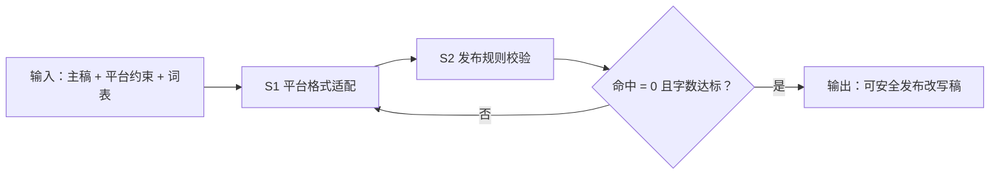

# 平台规则适配

把主稿推进到「可安全发布」：平台格式改写（S1）→ 广告法词表与字数校验（S2），
校验不通过不交付，带违规项退回重改。

## 元信息

| 字段 | 值 |
|------|-----|
| ID | `de_dev_05_wf02` |
| 类型 | **`composite`（复合技能）** |
| 所属员工 | 分发中控 |
| 阶段 | `P1` |
| 复杂度 | `S` |
| 触发方式 | 事件（录入后） |
| ROI | 省 0.5h/篇 |
| 资产形态 | 提示词编排 + Python 确定性脚本（无外部 API 依赖） |

> 复合技能 = 工作流。它把多个**原子技能**按业务顺序编排在一起，完成一个完整场景。

## 能力描述

1. **S1 平台格式改写**：按平台硬约束（小红书正文 ≤ 1000 字、抖音标题 ≤ 55 字、
   微博 ≤ 2000 字、B站动态 ≤ 233 字；话题标签区间）改写——长段拆为 ≤ 40 字
   编号短句，数字/价格/时间与原文逐项对照零改动
2. **S2 合规校验**：按禁用词表（缺省：最好/第一/100%/国家级/顶尖/天花板等
   绝对化用语）逐词扫描改写稿，命中必须引用原文片段；命中 > 0 → 未通过退回 S1；
   字数按脚本口径复核（汉字与标点合并计数）
3. **确定性脚本**：`scripts/run_flow.py` 按 DAG 逐节点推进（S2 读
   `out/step1_adapt.json`），产物落盘 `out/step1_adapt.json`、
   `out/step2_validate.json`、`out/校验报告.md`、`out/flow_result.json`

## 编排的原子技能

| # | 原子技能 | 能力 |
|---|---------|------|
| 1 | [平台格式适配](../../skills/platform-format-adapt/) | 保留原意的平台格式改写（字数/标签硬约束） |
| 2 | [发布规则校验](../../skills/publish-rules-validate/) | 校验字数/图片比例/违禁词（逐条引用原文） |

## 步骤链路（DAG）



## 步骤明细

| # | 步骤 | 技能资产 | 输入 | 输出 | 失败处理 |
|---|------|---------|------|------|---------|
| 1 | 平台格式适配 | [`../../skills/platform-format-adapt/`](../../skills/platform-format-adapt/) + 本流脚本 | 主稿 + 平台约束 | 改写稿 + 约束核对 | 超限二次压缩；事实被改即退回 |
| 2 | 发布规则校验 | [`../../skills/publish-rules-validate/`](../../skills/publish-rules-validate/) + 本流脚本 | step1_adapt.json + 词表 | 命中清单 + 判定 | 命中 > 0 退回 S1 重改 |

## 步骤说明

按 10+ 平台字数/图片/标签规则改写与校验

## 输入规格

| 字段 | 类型 | 必填 | 说明 |
|------|------|------|------|
| `input` | string / object | ✅ | 主稿原文 + 目标平台与字数要求 + 校验规则词表 |

## 输出规格

| 字段 | 类型 | 说明 |
|------|------|------|
| `summary` | string | 执行摘要（字数 / 命中数 / 判定） |
| `steps` | string | 分步结果（改写 + 校验明细） |
| `deliverable` | string | 校验通过的改写稿 + 校验报告 |
| 产物 | file | `out/step1_adapt.json`、`out/step2_validate.json`、`out/校验报告.md`、`out/flow_result.json` |

## 错误处理

| 情况 | 处理方式 |
|------|---------|
| 输入缺失 | 提示缺少的字段，终止流程 |
| 词表命中 | 逐条列出并退回 S1 重改，不放行 |
| 改写稿超字数上限 | 二次压缩（删冗余修饰 → 合并论据 → 压案例） |
| 提示词被平台截断 | 拆分任务，分两次处理 |

## 验收标准

- [ ] 每一步的技能资产齐全（SKILL.md / prompt.txt / schema.json）
- [ ] 步骤间输入输出字段可衔接（S2 读取 S1 的 step1_adapt.json）
- [ ] 校验通过稿对词表命中数为 0
- [ ] 每条判定引用原文片段
- [ ] 末步输出带 AI 生成标识

## 使用步骤

### 方式一：纯提示词编排（跨平台）

1. 把 `prompt.txt` 全文粘贴为系统提示词
2. 提供主稿原文 + 目标平台 + 校验词表
3. 按步骤 1 → 步骤 2 完成改写与校验
4. 数值（命中数、字数）用下方脚本实测，不靠模型口算

### 方式二：带脚本（端到端产物）

```bash
python <WF_DIR>/scripts/run_flow.py --input examples/input.json --outdir out
python <WF_DIR>/scripts/run_flow.py --demo      # 无输入也能看端到端效果
```

| 平台 | 编排方式 |
|------|---------|
| **Coze / 扣子** | 工作流节点填 S1/S2 技能 prompt.txt，代码节点跑校验脚本 |
| **Dify** | Workflow → LLM 节点链 + 代码节点 |
| **WorkBuddy** | 新建 Skill 按 prompt.txt 步骤串联 |

## 边界（不做的事）

- ❌ 不定排期、不执行发布（交给 scheduled-publish-flow / 人工）
- ❌ 不放走词表命中项：命中必须逐条列出，不得合并省略
- ❌ 不改原文事实：数字、价格、时间改动即为不合格
- ❌ 不猜缺失字段——列缺失清单让用户补
- ❌ 不用模型口算字数与命中数——以脚本输出为准

## 调用示例

**输入**（`examples/input.json`）：《小户型收纳的 5 个实用技巧》主稿，
目标小红书 ≤ 300 字，校验词表（最好/第一/100%/国家级/顶尖/天花板）。

**输出**（脚本实跑）：改写稿约 280 字达标、5 个技巧编号重排、
数字零改动；词表命中 0 处 → 判定通过（低风险），
改写稿与校验报告落 `out/`。

## 所属工作流

本资产为复合技能（工作流），上游接 `content-single-entry-flow`（内容一次录入），
下游接 `scheduled-publish-flow`（定时发布）。

## 合规声明

- 输出标注「AI 生成内容」；校验通过后仍需人工复核再发布
- 改写仅限用户自有内容，不搬运、不洗稿第三方版权内容
- 词表版本随报告留档，便于追溯
