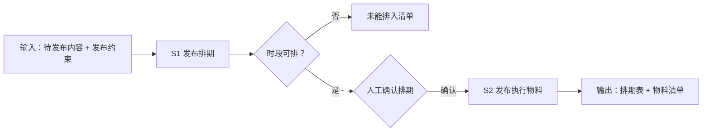

# 定时发布

把待发布内容从「计划」推进到「待人工执行」：发布排期（S1）→ 发布执行物料（S2）。
本工作流不自动发布——排期确认与实际发布都由人工完成。

## 元信息

| 字段 | 值 |
|------|-----|
| ID | `de_dev_05_wf03` |
| 类型 | **`composite`（复合技能）** |
| 所属员工 | 分发中控 |
| 阶段 | `P1` |
| 复杂度 | `M` |
| 触发方式 | 人工（内容就绪后） |
| ROI | — |
| 资产形态 | 提示词编排 + Python 确定性脚本（无外部 API 依赖） |

> 复合技能 = 工作流。它把多个**原子技能**按业务顺序编排在一起，完成一个完整场景。

## 能力描述

1. **S1 发布排期**：黄金时段（18:00-22:00）内按「间隔 ≥ 30 分钟」错峰分配，
   「排在最后」的版本排当日末位，同平台每日 ≤ 2 条；排不下进「未能排入」
   并给最近可排日期，不硬塞
2. **S2 发布执行物料**：文案须已过校验才可进清单（状态只取
   就绪 / 待备料 / 待校验 三值）；字段映射 6 项；失败重试提醒
   （报错 → 30 分钟后重试 1 次 → 仍失败改手工）
3. **确定性脚本**：`scripts/run_flow.py` 按 DAG 逐节点推进（S2 读
   `out/step1_schedule.json`），产物落盘 `out/step1_schedule.json`、
   `out/排期表.csv`、`out/step2_manifest.json`、`out/flow_result.json`

## 编排的原子技能

| # | 原子技能 | 能力 |
|---|---------|------|
| 1 | [发布排期](../../skills/publish-schedule/) | 内容×时间×平台排期与冲突处理（T4 调度型） |
| 2 | [发布执行](../../skills/publish-execute/) | 发布物料包与操作清单整理（T4 调度型，不自动发布） |

## 步骤链路（DAG）



## 步骤明细

| # | 步骤 | 技能资产 | 输入 | 输出 | 失败处理 |
|---|------|---------|------|------|---------|
| 1 | 发布排期 | [`../../skills/publish-schedule/`](../../skills/publish-schedule/) + 本流脚本 | 内容版本 + 约束 | 排期表 + 冲突清单 | 时段排不下进「未能排入」 |
| 2 | 发布执行物料 | [`../../skills/publish-execute/`](../../skills/publish-execute/) + 本流脚本 | step1_schedule.json | 物料清单 + 检查项 | 未过校验标「待校验」不进清单 |

## 步骤说明

生成发布计划 → 整理发布物料与操作清单 → 失败重试提醒

## 输入规格

| 字段 | 类型 | 必填 | 说明 |
|------|------|------|------|
| `input` | string / object | ✅ | 待发布内容（各平台版本字数与素材状态）+ 发布约束（时段/间隔/顺序/频率） |

## 输出规格

| 字段 | 类型 | 说明 |
|------|------|------|
| `summary` | string | 执行摘要（排期数 / 错峰 / 物料就绪数） |
| `steps` | string | 分步结果（排期表 + 物料清单） |
| `deliverable` | string | 排期表 + 物料清单（实际发布由人工执行） |
| 产物 | file | `out/step1_schedule.json`、`out/排期表.csv`、`out/step2_manifest.json`、`out/flow_result.json` |

## 错误处理

| 情况 | 处理方式 |
|------|---------|
| 输入缺失 | 提示缺少的字段，终止流程 |
| 版本解析 0 条 | 中止并列出期望格式，不虚构条目 |
| 超频率上限 | 移入「未能排入」并给最近可排日期 |
| 平台发布报错（人工执行时） | 截图报错 → 30 分钟后重试 1 次 → 改手工并记录 |

## 验收标准

- [ ] 每一步的技能资产齐全（SKILL.md / prompt.txt / schema.json）
- [ ] 步骤间输入输出字段可衔接（S2 读取 S1 的 step1_schedule.json）
- [ ] 同日两条间隔 ≥ 30 分钟，指定末位的版本排当日最后
- [ ] 物料状态只取就绪 / 待备料 / 待校验 三值
- [ ] 排期表标注「待人工确认」；末步输出带 AI 生成标识

## 使用步骤

### 方式一：纯提示词编排（跨平台）

1. 把 `prompt.txt` 全文粘贴为系统提示词
2. 提供待发布内容与发布约束
3. 按步骤 1 → 步骤 2 得到排期表与物料清单，排期经人工确认
4. 时间与间隔用下方脚本实测，不靠模型口算

### 方式二：带脚本（端到端产物）

```bash
python <WF_DIR>/scripts/run_flow.py --input examples/input.json --outdir out
python <WF_DIR>/scripts/run_flow.py --demo      # 无输入也能看端到端效果
```

| 平台 | 编排方式 |
|------|---------|
| **Coze / 扣子** | 工作流节点填 S1/S2 技能 prompt.txt，代码节点跑排期脚本 |
| **Dify** | Workflow → LLM 节点链 + 代码节点 |
| **WorkBuddy** | 新建 Skill 按 prompt.txt 步骤串联 |

## 边界（不做的事）

- ❌ 不执行任何自动发布动作；无平台写权限
- ❌ 不编造「已发布成功」的状态——发布事实以人工回填为准
- ❌ 不为刷量动作排位（集中点赞、互推群、定时轰炸式连发）
- ❌ 不替人工确认排期——确认环节必须人工完成
- ❌ 不涉及资金操作或代替用户做最终决策

## 调用示例

**输入**（`examples/input.json`）：《秋季收纳好物清单（上）》三平台版本
（小红书 / 知乎 / B站动态），约束：2026-10-09 黄金时段、间隔 ≥ 30 分钟、
B站动态版排最后、每平台每日 1 条。

**输出**（脚本实跑）：小红书 19:00 → 知乎 19:45 → B站动态 20:30 错峰排期
（B站末位）；物料清单 3 条 + 发布前检查 5 项 + 失败重试提醒落 `out/`。

## 所属工作流

本资产为复合技能（工作流），上游接 `content-single-entry-flow`（内容一次录入）
与 `publish-rules-adapt-flow`（规则适配与校验），发布结果由
`publish-data-retrieval-flow` 回捞。

## 合规声明

- 输出标注「AI 生成内容」；排期经人工确认，发布由人工在各平台执行
- 各平台按平台要求配置 AI 生成内容标识
- 连接器仅只读（平台创作者后台人工登录核对）；账号信息不落盘、不外传
